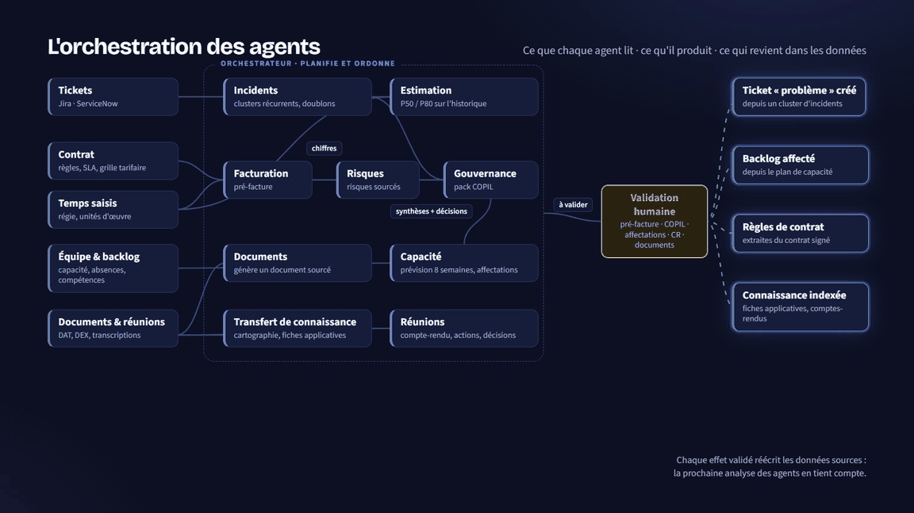

I'm a QA automation engineer at Capgemini Engineering in Tunis, and a software engineering student at ESPRIT.

At work I automate tests for Citrix applications. There is no DOM to target there, so it's mostly image-based automation with Robot Framework and SikuliX, plus Playwright in Java for the web side, all running in Jenkins and GitHub Actions. Before that I spent a few years building web apps, and I still do on the side.

## Projects

### [DeliveryOps](https://github.com/YoussefTakali/deliveryops)
A multi-agent platform for application-maintenance teams. The agents read a project's real data (Jira exports, the contract, timesheets, meeting transcripts) and prepare the pre-invoice, the steering committee deck and the capacity plan. Nothing is applied until a person approves it. Built with FastAPI, LangGraph, Angular and PostgreSQL with pgvector for the Capgemini ER&D Tunisia hackathon.

### [Jobify](https://github.com/YoussefTakali/jobify)
Pulls job offers from public job APIs, ranks them against my CV with an LLM, and drafts a CV and cover letter for the good ones. Spring Boot and Angular, with a browser extension that fills in application forms.

### [EspritHub](https://github.com/YoussefTakali/esprithub)
A project platform for ESPRIT students and teachers, built on the GitHub API: OAuth login, webhooks that keep commits and branches in sync, separate spaces for students, teachers and admins. Angular, Spring Boot, PostgreSQL. Built with two classmates.

### [Hyprland desktop](https://github.com/YoussefTakali/hyprland-dotfiles)
My Fedora setup, with a graphical installer so anyone can use it. Custom lock screen, Waybar, and colours that follow the wallpaper.

### [DeepSearch](https://github.com/YoussefTakali/deepsearch)
A file search tool in Python that indexes folders into SQLite and supports fuzzy and full-text search.

## What I use

- **Testing:** Robot Framework, SikuliX, Playwright, Squash TM, Jira
- **Backend:** Java and Spring Boot, Python (FastAPI, Django), NestJS
- **Frontend:** Angular, React, TypeScript
- **Ops:** Docker, Kubernetes, Jenkins, GitHub Actions, Linux

## Experience

- **QA Automation Engineer**, Capgemini Engineering, Dec 2025 to now
- **Software Developer**, UmanlinkGroup Digital Services, Sep 2024 to May 2025
- **Freelance Developer**, Pixel Pulsar, 2023 to 2025
- **Backend Developer**, Sfectoria, Dec 2023 to Jun 2024
- **Frontend Developer**, Atlax, Jun 2023 to Sep 2023

Engineering degree at ESPRIT (expected 2028), bachelor's in computer science from ISI Ariana (2024). ISTQB CTFL and CCNA certified.

I speak Arabic, English, French and a bit of Swedish. The easiest way to reach me is [LinkedIn](https://linkedin.com/in/yousseftakali).
