  

  

  

  

  
  

  
  

  

<b>QA Automation Engineer</b> · Capgemini Engineering · <i>Dec 2025 – present</i>

 

- Test automation for Citrix-based enterprise applications, using SikuliX image-based automation where DOM locators are unavailable
- Robot Framework suites for functional and regression testing, extended with my own OculixLibrary
- Playwright test automation in Java following the Page Object Model
- Robot Framework – Squash TM – Jira integration: auto-detects tests, maps them to Squash TM test cases, syncs status in real time and links results to Jira defects
- Automated suites run as pre-deployment quality gates in Jenkins and GitHub Actions; I also mentor incoming interns

<b>Software Developer & QA Contributor</b> · UmanlinkGroup Digital Services · <i>Sep 2024 – May 2025</i>

 

- Architected three e-commerce platforms with unit and integration testing built into the workflow
- Built a MEAN recruitment platform connecting 500+ bike delivery agents with real-time geolocation and dynamic routing
- Built an automated client-discovery system processing 200+ leads per month (+40% conversion)
- Built a multithreaded job-board scraper with Tor circuit rotation: 20× faster, 1,000+ concurrent requests

<b>Freelance QA & Full-Stack Developer</b> · Pixel Pulsar · <i>2023 – 2025</i>

 

- Manual and automated functional, regression and UI testing for web-app clients
- Delivered full-stack web apps and mentored junior developers and interns

<b>Backend Developer</b> · Sfectoria · <i>Dec 2023 – Jun 2024</i>

 

- Points-based resource management platform with NestJS and Prisma serving 500+ users
- Containerized services with Docker: 70% faster deployments, 99.9% uptime

<b>Frontend Developer</b> · Atlax · <i>Jun 2023 – Sep 2023</i>

 

- Led the company website in React.js (+45% user engagement)
- Cross-browser and performance work: 95+ PageSpeed score, 40% faster load time

 

  

  
  
  
  
  

  

