

  <a href="https://linkedin.com/in/yousseftakali"><picture><source media="(max-width: 600px)" srcset="assets/header-m.svg"></picture></a>

  <picture><source media="(max-width: 600px)" srcset="assets/about-m.svg"></picture>

  <a href="https://github.com/YoussefTakali?tab=repositories"><picture><source media="(max-width: 600px)" srcset="assets/bar-projects-m.svg"></picture></a>

  <a href="https://github.com/YoussefTakali/deliveryops"><picture><source media="(max-width: 600px)" srcset="assets/p-deliveryops-m.svg"></picture></a>

  <a href="https://github.com/YoussefTakali/jobify"><picture><source media="(max-width: 600px)" srcset="assets/p-jobify-m.svg"></picture></a>

  <a href="https://github.com/YoussefTakali/esprithub"><picture><source media="(max-width: 600px)" srcset="assets/p-esprithub-m.svg"></picture></a>

  <a href="https://github.com/YoussefTakali/hyprland-dotfiles"><picture><source media="(max-width: 600px)" srcset="assets/p-hyprland-m.svg"></picture></a>

  <a href="https://github.com/YoussefTakali/deepsearch"><picture><source media="(max-width: 600px)" srcset="assets/p-deepsearch-m.svg"></picture></a>

  <picture><source media="(max-width: 600px)" srcset="assets/bar-experience-m.svg"></picture>

<b>QA Automation Engineer</b>, Capgemini Engineering, <i>Dec 2025 to present</i>

 

- Test automation for Citrix-based enterprise applications, using SikuliX image-based automation where DOM locators are unavailable
- Robot Framework suites for functional and regression testing, extended with my own OculixLibrary
- Playwright test automation in Java following the Page Object Model
- Robot Framework to Squash TM to Jira integration: auto-detects tests, maps them to Squash TM test cases, syncs status in real time and links results to Jira defects
- Automated suites run as pre-deployment quality gates in Jenkins and GitHub Actions; I also mentor incoming interns

<b>Software Developer & QA Contributor</b>, UmanlinkGroup Digital Services, <i>Sep 2024 to May 2025</i>

 

- Architected three e-commerce platforms with unit and integration testing built into the workflow
- Built a MEAN recruitment platform connecting 500+ bike delivery agents with real-time geolocation and dynamic routing
- Built an automated client-discovery system processing 200+ leads per month (+40% conversion)
- Built a multithreaded job-board scraper with Tor circuit rotation: 20× faster, 1,000+ concurrent requests

<b>Freelance QA & Full-Stack Developer</b>, Pixel Pulsar, <i>2023 to 2025</i>

 

- Manual and automated functional, regression and UI testing for web-app clients
- Delivered full-stack web apps and mentored junior developers and interns

<b>Backend Developer</b>, Sfectoria, <i>Dec 2023 to Jun 2024</i>

 

- Points-based resource management platform with NestJS and Prisma serving 500+ users
- Containerized services with Docker: 70% faster deployments, 99.9% uptime

<b>Frontend Developer</b>, Atlax, <i>Jun 2023 to Sep 2023</i>

 

- Led the company website in React.js (+45% user engagement)
- Cross-browser and performance work: 95+ PageSpeed score, 40% faster load time

 

  <a href="https://linkedin.com/in/yousseftakali"><picture><source media="(max-width: 600px)" srcset="assets/footer-m.svg"></picture></a>

  <a href="https://linkedin.com/in/yousseftakali"><picture><source media="(max-width: 600px)" srcset="assets/o-linkedin-m.svg">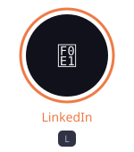</picture></a>
  <a href="https://github.com/YoussefTakali"><picture><source media="(max-width: 600px)" srcset="assets/o-github-m.svg">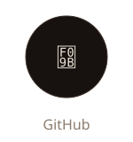</picture></a>
  <a href="https://github.com/YoussefTakali/deliveryops"><picture><source media="(max-width: 600px)" srcset="assets/o-deliveryops-m.svg">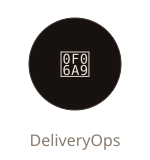</picture></a>
  <a href="https://github.com/YoussefTakali/jobify"><picture><source media="(max-width: 600px)" srcset="assets/o-jobify-m.svg">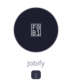</picture></a>
  <a href="https://github.com/YoussefTakali/hyprland-dotfiles"><picture><source media="(max-width: 600px)" srcset="assets/o-dotfiles-m.svg">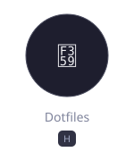</picture></a>

